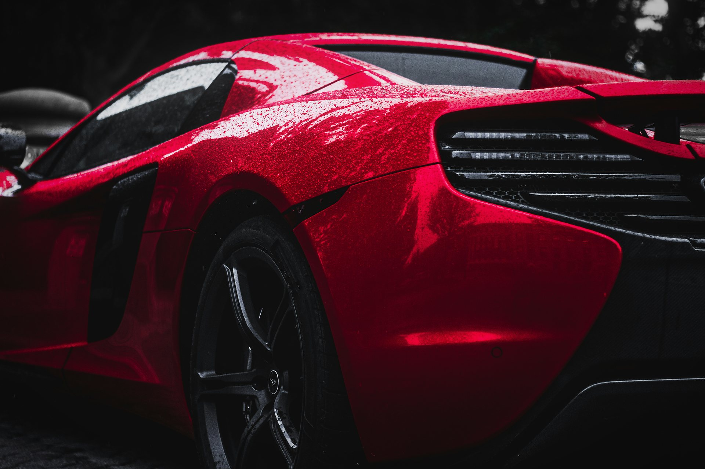
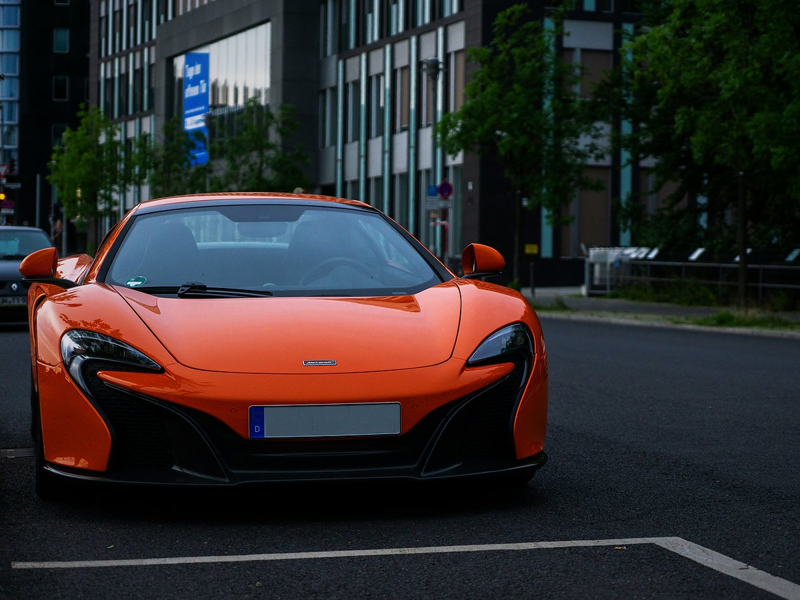
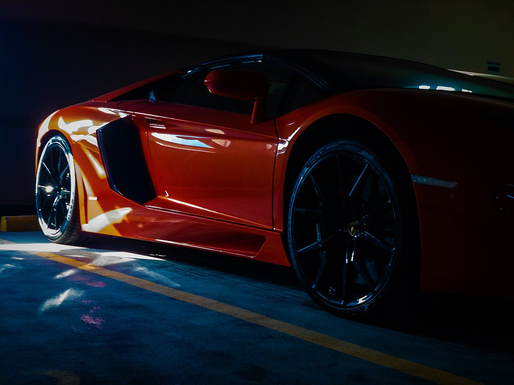
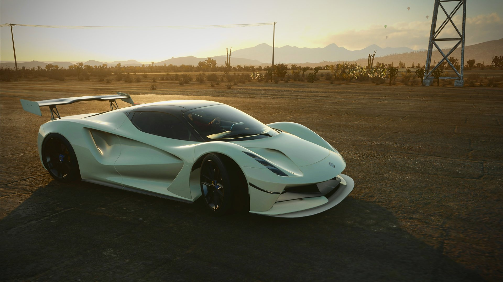

# NoirMotors

> **La puissance est un art.**
> Une vitrine digitale dédiée aux voitures d'exception.

<p align="center">
  
</p>

<p align="center">
  
</p>

NoirMotors présente une sélection de voitures de luxe dans une expérience immersive et responsive. Le site met en valeur les véhicules, leurs performances et les services qui accompagnent un projet d'acquisition.

## Découvrir le site

- **Explorer la collection** et filtrer les véhicules par catégorie : supercars, sportives, grand tourisme et éditions limitées.
- **Consulter les fiches détaillées** avec les caractéristiques et les points forts de chaque modèle.
- **Découvrir l'univers NoirMotors**, ses performances et les étapes d'un parcours d'acquisition.
- **Poser une question** ou préparer une demande de renseignements, d'essai ou d'acquisition.

## Un aperçu de la collection

<table>
  <tr>
    <td></td>
    <td></td>
    <td></td>
  </tr>
</table>

La collection est une sélection de modèles emblématiques présentés à titre de vitrine. Les disponibilités, prix et informations propres à un exemplaire sont communiqués sur demande.

<p align="center">
  
</p>

## Fonctionnalités

- Navigation adaptée aux écrans mobiles et ordinateurs.
- Filtres de collection et fiches véhicules interactives.
- Thème clair ou sombre, avec préférence mémorisée.
- FAQ, formulaire de contact et présentation des étapes d'acquisition.
- Images responsives et chargement différé pour les visuels de la collection.
- Prise en compte de la préférence de réduction des animations.

> **À noter :** le formulaire est une démonstration côté navigateur. Il ne transmet pas les demandes à un serveur.

## Lancer le site

Aucune installation ni dépendance n'est nécessaire. Ouvrez simplement `index.html` dans un navigateur.

Pour le servir en local avec Python :

```bash
python -m http.server 8000
```

Puis ouvrez [http://localhost:8000](http://localhost:8000).

## Technologies et fichiers

- **HTML** pour le contenu et la structure.
- **CSS** pour la mise en page responsive et les thèmes.
- **JavaScript natif** pour les filtres, fiches et interactions.
- `assets/` contient le logo, le favicon et les images du site, déclinées en plusieurs résolutions.

```text
index.html   Structure et sections de la page
style.css    Présentation, responsive et thèmes
script.js    Collection et interactions
assets/      Images, logo et favicon
```

Les caractéristiques automobiles affichées sont indicatives et peuvent varier selon la version et les options. Les marques et logos visibles restent la propriété de leurs détenteurs.
